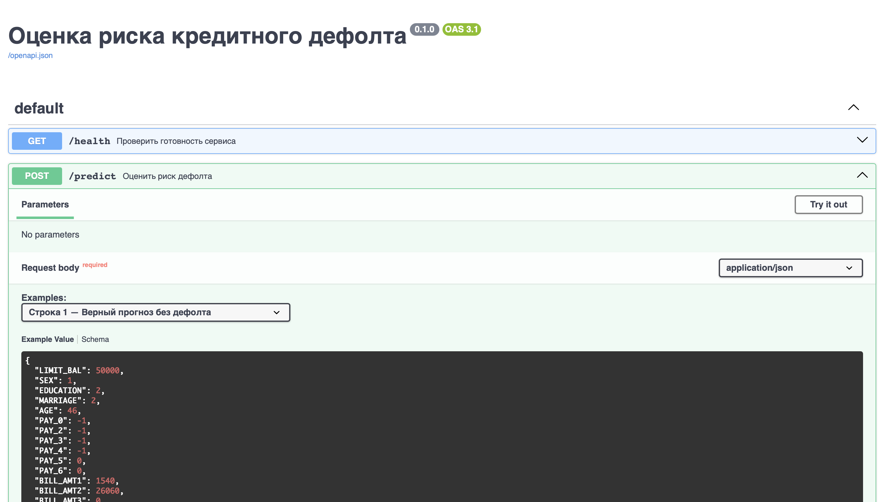
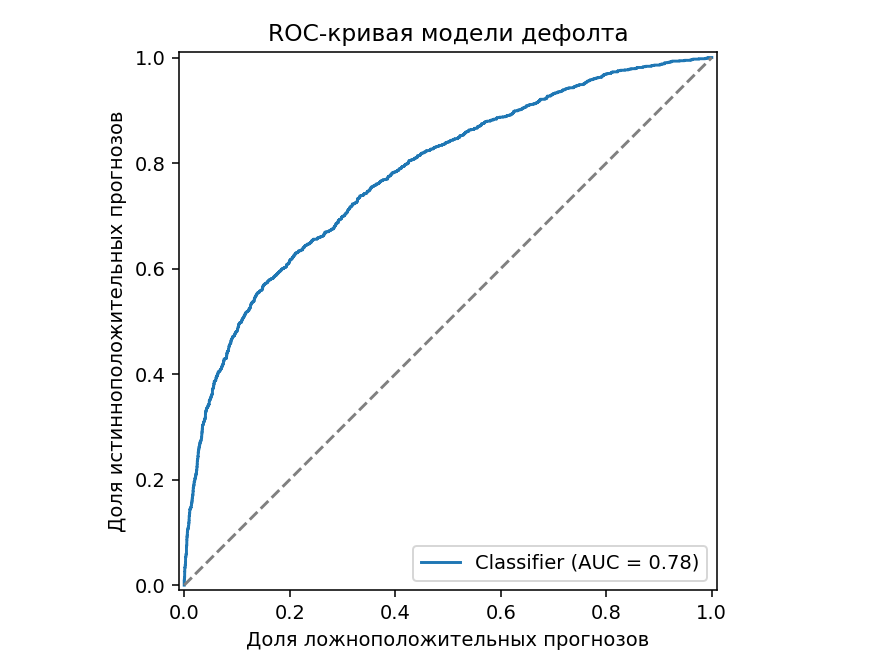
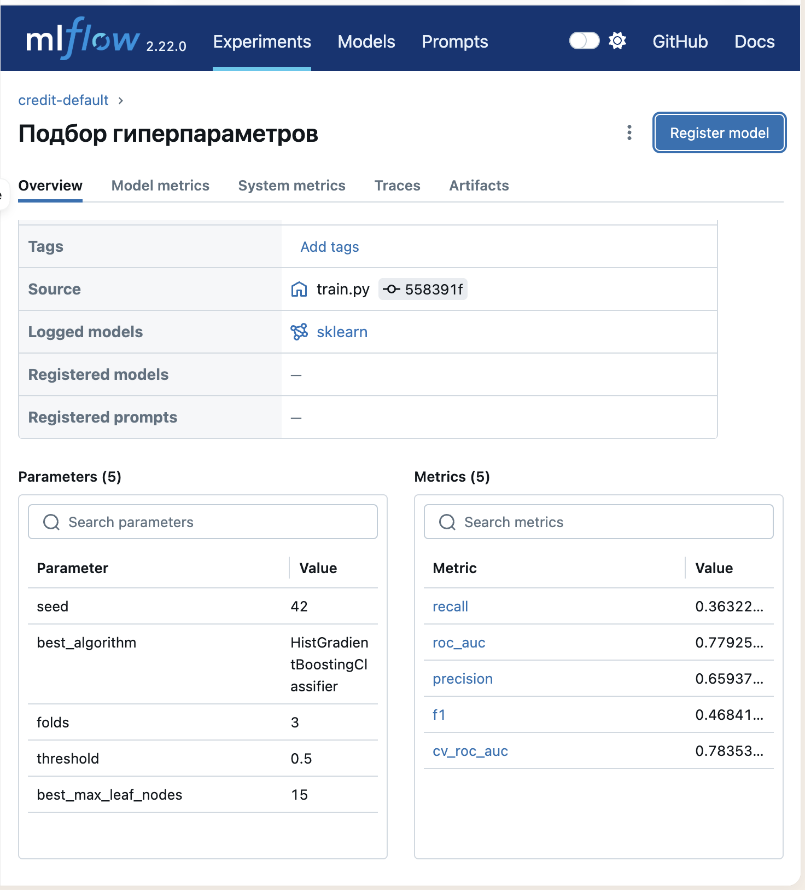
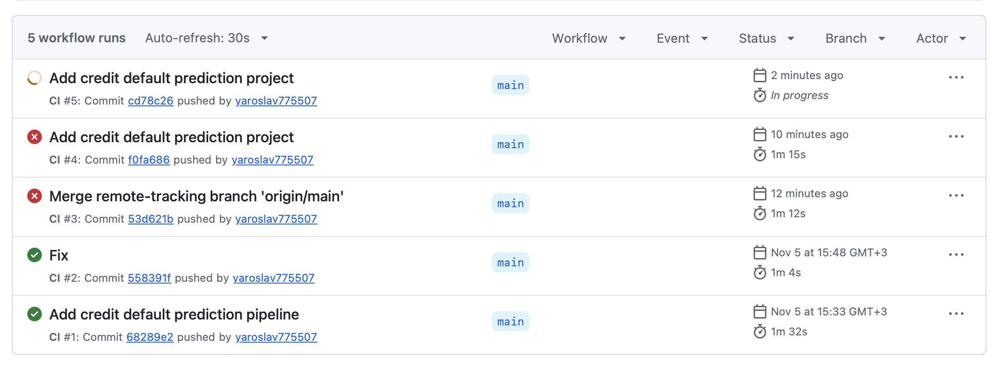

# Прогноз дефолта по кредитной карте

Модель оценивает вероятность того, что клиент не выполнит платёжные обязательства в следующем месяце. На входе — кредитный лимит, данные о клиенте и история счетов и платежей за шесть месяцев. Проект проверяет данные, обучает модель, сохраняет результаты экспериментов в MLflow и отдаёт прогноз через локальный API.

Источник данных — I-Cheng Yeh, [Default of Credit Card Clients](https://archive.ics.uci.edu/dataset/350/default), DOI 10.24432/C55S3H, лицензия CC BY 4.0.

## С чего начать

Для проекта нужен **Python 3.12**. Открой в PyCharm папку `cookiecutter-data-science` целиком. Все команды в этом README выполняются из её корня — там лежат `README.md`, `requirements.txt` и `dvc.yaml`.

Порядок работы один и тот же для терминала и кнопки **Run**.

1. Если исходного CSV ещё нет, скачай его.
2. Проверь и подготовь данные.
3. Обучи модель и посмотри метрики.
4. Запусти API и проверь прогноз в Swagger.
5. При запущенном API можно проверить дрейф прогнозов. Результаты обучения также можно посмотреть в MLflow.

### Окружение и зависимости

Если у тебя уже есть окружение для проекта на Python 3.12, активируй его и переходи к запуску. Если окружения ещё нет, создай его один раз.

```bash
python3.12 -m venv "$HOME/.venvs/cookiecutter-data-science"
source "$HOME/.venvs/cookiecutter-data-science/bin/activate"
python --version
python -m pip install -r requirements.txt
```

`python --version` должен показать `Python 3.12.x`. Если на macOS команда `python3.12` не находится, а Python 3.12 установлен через Homebrew на Apple Silicon, используй `/opt/homebrew/bin/python3.12` в первой команде. При открытии нового терминала повтори `source`, чтобы команды использовали нужное окружение.

Проверить, что Great Expectations доступен в этом окружении, можно командой:

```bash
python -c 'import great_expectations as gx; print(gx.__version__)'
```

Ожидаемая версия — `0.18.22`.

## Вариант 1. Запуск через терминал

### 1. Подготовь исходный CSV

Проверь, есть ли `data/UCI_Credit_Card.csv`. Если файла нет, запусти скрипт загрузки. Он скачает исходник UCI и сохранит его в нужной папке проекта.

```bash
python scripts/download_uci.py
```

Если CSV уже есть, переходи к следующему шагу.

### 2. Проверь и очисти данные

```bash
PYTHONPATH=src python -m pd_model.data prepare
```

Команда запускает [data.py](src/pd_model/data.py). Great Expectations проверяет состав столбцов, типы, пропуски, диапазоны и уникальность `ID`. После успешной проверки скрипт убирает `ID`, приводит нестандартные коды образования и семейного положения к категории «прочие» и сохраняет `data/processed/clients.csv`. Для полного датасета в консоли появится сообщение о **30 000 проверенных строках**.

Если нужно только проверить CSV, выполни `PYTHONPATH=src python -m pd_model.data validate`. Для другого входного файла добавь `--input путь/к/файлу.csv`.

### 3. Обучи модель

```bash
PYTHONPATH=src python -m pd_model.train
```

[train.py](src/pd_model/train.py) читает очищенный CSV, откладывает 20% данных для итоговой оценки и сравнивает шесть конфигураций на тренировочной части с помощью `GridSearchCV`. Встроенный [sklearn Pipeline](src/pd_model/pipeline.py) создаёт возрастную группу и агрегаты по истории платежей, затем применяет импутацию, масштабирование и one-hot-кодирование.

После завершения в терминале появится JSON. В `winner` указана лучшая конфигурация, а в `test_metrics` — ROC-AUC, Precision, Recall и F1 на отложенных данных. Скрипт сохранит модель в `models/pd_model.joblib`, [метрики](reports/metrics.json) и [ROC-кривую](reports/roc.png).

**Автоматический запуск через DVC.** Вместо отдельных команд подготовки и обучения можно выполнить `dvc repro` после того, как исходный CSV окажется на месте. DVC выполняет стадии `prepare` и `train` в этом порядке и пропускает актуальные стадии. Для полного повторного прогона используй `dvc repro --force`. [Конфигурация стадий](dvc.yaml)

### 4. Запусти API

```bash
PYTHONPATH=src python -m uvicorn pd_model.api:app
```

Оставь сервер запущенным и открой [Swagger UI](http://127.0.0.1:8000/docs). Как отправить первый запрос, описано ниже.

Если Docker уже установлен и запущен, API можно поднять командой `./scripts/docker_run.sh`. Образ включает обученную модель, поэтому сначала выполни шаг обучения.

### 5. Запусти мониторинг

Открой второй терминал в корне проекта, активируй окружение и выполни:

```bash
PYTHONPATH=src python -m pd_model.monitor --sample 300
```

Скрипт отправит 300 строк из отложенной выборки на локальный `/predict` и посчитает PSI. Он сравнивает распределение полученных прогнозов с прогнозами модели на тренировочных данных. Для быстрой проверки связи с API можно взять `--sample 10`.

## Вариант 2. Запуск кнопкой Run в PyCharm

### Выбери интерпретатор проекта

В **Settings → Python → Interpreter** нажми **Add Interpreter → Add Local Interpreter…**. Выбери существующее окружение и укажи его исполняемый файл `bin/python`. Если ты создал окружение по инструкции выше, на Mac Ярослава полный путь будет таким:

```text
/Users/yaroslav/.venvs/cookiecutter-data-science/bin/python
```

Убедись, что рядом с интерпретатором показана версия **3.12**. Зависимости для него устанавливаются из `requirements.txt` командой из раздела про окружение.

### Создай конфигурации Run

Открой **Run → Edit Configurations…**, нажми **+** и выбери **Python**. Для каждой конфигурации выбери интерпретатор проекта на Python 3.12. В **Working directory** укажи корень репозитория. На Mac Ярослава это:

```text
/Users/yaroslav/Documents/Python/cookiecutter-data-science
```

В **Environment variables** добавь `PYTHONPATH`, указав полный путь к папке `src`. На другом компьютере подставь свой путь. Если в поле уже есть `PYTHONUNBUFFERED=1`, сохрани его и раздели настройки точкой с запятой.

```text
PYTHONUNBUFFERED=1;PYTHONPATH=/Users/yaroslav/Documents/Python/cookiecutter-data-science/src
```

Под выбором интерпретатора есть переключатель **script/module**. Выбери режим для нужной строки таблицы, впиши значение в поле справа и задай параметры отдельным полем **Script parameters**. Нажми **Apply**. Чтобы не вводить рабочую папку и окружение заново, скопируй первую конфигурацию для остальных шагов.

| Название | Режим | Поле справа от переключателя | Script parameters |
| --- | --- | --- | --- |
| Загрузка CSV | `script` | Выбери файл `scripts/download_uci.py` через значок папки | Оставь пустым |
| Подготовка данных | `module` | `pd_model.data` | `prepare` |
| Обучение модели | `module` | `pd_model.train` | Оставь пустым |
| API модели | `module` | `uvicorn` | `pd_model.api:app` |
| Мониторинг | `module` | `pd_model.monitor` | `--sample 300` |
| Интерфейс MLflow | `module` | `mlflow` | `ui --backend-store-uri ./mlruns` |

Запускай **«Подготовка данных» → «Обучение модели» → «API модели»**. Если CSV ещё отсутствует, начни с **«Загрузка CSV»**. После подготовки и обучения дождись `Process finished with exit code 0`. Для API дождись сообщения о запуске Uvicorn и оставь его работать, пока проверяешь Swagger или запускаешь **«Мониторинг»**.

Если при нажатии Run появляется `attempted relative import with no known parent package`, PyCharm запустил файл `data.py` или `train.py` в режиме `script`. Выбери созданную конфигурацию в списке рядом с кнопкой Run и проверь, что в ней стоит режим `module`. Импорты вроде `from .schema import …` используют контекст пакета `pd_model`, а `PYTHONPATH` указывает, где его найти. [Настройки конфигураций Python в PyCharm](https://www.jetbrains.com/help/pycharm/run-debug-configuration-python.html)

## Как проверить прогноз в Swagger

1. Открой [Swagger UI](http://127.0.0.1:8000/docs) и выполни **GET /health → Try it out → Execute**. При успешном запуске сервер вернёт код `200` и сообщение «Сервис готов к работе».
2. Открой **POST /predict → Try it out**. В списке **Examples** выбери одну из четырёх строк отложенной выборки. Swagger заполнит JSON с 23 входными признаками. Описание примера покажет, откуда взялась строка и какая метка была в тестовых данных.
3. Нажми **Execute** и посмотри **Response body**. Например, для строки 29 в сохранённом запуске модель вернула `prediction: 1` и вероятность около **76,9%**.

`probability` — оценка вероятности дефолта от 0 до 1. `prediction` равен `1` при вероятности от 50% и `0` при меньшей вероятности. Значения в блоке **Example Value** внизу описывают формат ответа. [Исходные JSON-примеры](src/pd_model/predict_examples.json)



## Что видно в данных до обучения

Разведочный анализ выполнен на **24 000 тренировочных строках** того же стратифицированного разбиения 80/20 с `random_state=42`, которое использует обучение. Пропусков в этой части нет. Таблицы и три графика можно открыть в [ноутбуке EDA](notebooks/01_eda.ipynb).

- **Дефолт — менее частый класс.** У 18 691 клиента (77,88%) дефолта не было, у 5 309 (22,12%) он произошёл. Поэтому при оценке модели важен Recall, который показывает, какую долю реальных дефолтов удалось выявить.
- **Медианный возраст — 34 года.** В тренировочной выборке возраст клиентов составляет от 21 до 75 лет. В пайплайне исходный возраст сохраняется, а рядом добавляется возрастная группа.
- **У денежных признаков заметен правый хвост.** Среднее значение последнего счёта — около 51 101 NT$, медиана — 22 330 NT$. Для последнего платежа среднее составляет около 5 624 NT$, а медиана — 2 100,50 NT$. У 468 клиентов последний счёт отрицательный. Код сохраняет такие суммы при подготовке данных.
- **Встречаются нестандартные коды категорий.** В `EDUCATION` значения `0`, `5` и `6` встретились 289 раз суммарно и приводятся к `4` («прочие»). В `MARRIAGE` значение `0` встретилось 47 раз и приводится к `3` («прочие»).

### Как последний статус платежа связан с дефолтом

`PAY_0` — статус платежа за последний наблюдаемый месяц. Для каждой группы доля дефолта рассчитана как число дефолтов в следующем месяце, делённое на число клиентов с таким статусом.

| `PAY_0` | Клиентов | Дефолтов | Доля дефолта |
| ---: | ---: | ---: | ---: |
| −2 | 2 198 | 279 | 12,7% |
| −1 | 4 527 | 753 | 16,6% |
| 0 | 11 781 | 1 508 | 12,8% |
| 1 | 3 000 | 1 031 | 34,4% |
| 2 | 2 138 | 1 483 | 69,4% |
| 3 | 245 | 188 | 76,7% |
| 4 | 58 | 38 | 65,5% |

На графике показаны группы от 30 клиентов. Коды `5`–`8` встречаются реже, поэтому их нет на графике. Самый заметный перепад виден между статусами `0`, `1` и `2`. Пайплайн сохраняет все шесть месячных статусов и дополнительно считает максимальную просрочку и число месяцев с просрочкой. [Код расчёта признаков](src/pd_model/pipeline.py)

## Где посмотреть результаты

| Что посмотреть | Где находится |
| --- | --- |
| Подготовленные данные | `data/processed/clients.csv` |
| Отложенные данные | `data/processed/test.csv` |
| Модель вместе с предобработкой | `models/pd_model.joblib` |
| Итоговые метрики и сравнение конфигураций | [reports/metrics.json](reports/metrics.json) |
| ROC-кривая | [reports/roc.png](reports/roc.png) |
| Разведочный анализ данных | [notebooks/01_eda.ipynb](notebooks/01_eda.ipynb) |

В сохранённом запуске победил градиентный бустинг с 15 листьями. Для **6 000 клиентов** на тесте получились следующие значения.

| ROC-AUC | Precision | Recall | F1 | Accuracy |
| ---: | ---: | ---: | ---: | ---: |
| 0,7793 | 0,6594 | 0,3632 | 0,4684 | 81,77% |

**Accuracy (81,77%)** — доля верных ответов по обоим классам. При пороге 0,5 сохранённая модель верно классифицировала 4 906 из 6 000 клиентов. Этот показатель рассчитан отдельно по прогнозам модели на отложенной выборке.

**Precision (65,94%)** — доля реальных дефолтов среди клиентов, которым модель предсказала дефолт. После обучения она появляется в консоли и в поле `test_metrics.precision`. В MLflow метрика называется `precision`. [Отчёт с метриками](reports/metrics.json)



Синяя линия показывает, как меняется доля найденных дефолтов при разных порогах решения. Серая диагональ служит ориентиром для случайного ранжирования. Площадь под кривой на тесте — **0,7793**.

Чтобы открыть историю экспериментов, запусти конфигурацию **«Интерфейс MLflow»** или выполни из корня проекта в активированном окружении:

```bash
python -m mlflow ui --backend-store-uri ./mlruns
```

Открой [MLflow UI](http://127.0.0.1:5000), выбери эксперимент `credit-default` и запуск **«Подбор гиперпараметров»**. В нём лежат итоговые метрики, ROC-кривая и модель. Шесть дочерних запусков показывают параметры и оценки кросс-валидации для каждой конфигурации.



Во вкладке **Overview** слева видны параметры победителя, а справа — итоговые метрики. `roc_auc` — оценка на отложенном тесте, `cv_roc_auc` — средняя оценка на трёх фолдах тренировочной выборки.

## Как устроен проект

- [src/pd_model](src/pd_model) — подготовка данных, пайплайн, обучение, API и мониторинг.
- [scripts](scripts) — загрузка исходных данных и запуск API в Docker.
- [tests](tests) — тесты подготовки, валидации, метрик и API.
- [dvc.yaml](dvc.yaml) и [dvc.lock](dvc.lock) — порядок стадий и зафиксированные версии входов и результатов. Исходный CSV отслеживается через [DVC-указатель](data/UCI_Credit_Card.csv.dvc). Если используешь другой экземпляр CSV из UCI, его хеш может отличаться. При настроенном DVC remote точную версию можно получить через `dvc pull`.

Проверки проекта выполняются из корня репозитория в активированном окружении.

```bash
python -m pytest -q
python -m black --check src scripts tests
python -m flake8 src scripts tests
PYTHONPATH=src python -m pd_model.data validate
```

[GitHub Actions](.github/workflows/ci.yml) запускает проверки при push и pull request. Для шага Great Expectations он отдельно скачивает оригинальные данные UCI. На снимке видна история запусков CI, а текущий статус можно посмотреть на [вкладке Actions](https://github.com/yaroslav775507/cookiecutter-data-science/actions).


